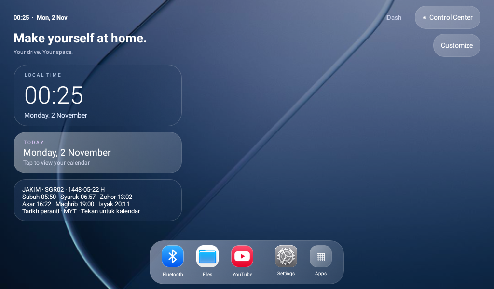

# iDash

An iPad-inspired Android launcher for landscape car head units. Floating glass dock, rounded widgets, an App Library and a Control Center, built with native Android views and no third-party runtime dependencies.



[Wallpaper gallery](docs/wallpapers.png) · [Optional web panel preview](docs/optional-panel.png) · [FM panel preview](docs/fm-panel.png)

[MRiOS-themed App Library preview (0.1.2)](docs/app-library.png) · [Icon Control Center preview (0.1.4)](docs/control-center.png)

## Try the preview

[Download iDash 0.1.7 preview](dist/iDash-0.1.7-preview.apk?raw=true) · Android8.0/API26 or newer · package `com.shazwan.idash`

Install alongside your existing launcher. Open **iDash** from the app list first. To make it your home app, open **Control Center → Choose default launcher** and select iDash yourself. Retain the original launcher as a fallback. Android installation may ask you to allow installs from your file manager/browser.

## Included

- Landscape dashboard without a Favorites section, with translucent rounded cards,24 MRiOS wallpapers and two original gradient palettes.
- Compact local clock/date, a browsable Gregorian calendar and an official JAKIM prayer-times widget with next-prayer countdown, replacing Power. Clock, prayers and calendar share one scroll area; prayers come before the calendar. Scroll on shorter displays. Select your zone explicitly; no GPS permission is requested.
- Three shortcuts — Bluetooth, Files, YouTube — in the floating dock only. Hold a favorite to select its app, or hold an App Library icon to assign it. Assignments persist across restarts.
- App Library with installed application icons, live name search, Refresh and Back/Done navigation.
- Icon-based Control Center with Android Wi-Fi, Bluetooth, display, sound and default-home settings links, plus a real media-volume slider. OEM hardware may handle volume differently.
- Customize: calendar/JAKIM visibility,24/12-hour time, MRiOS icon theme, thumbnail Wallpapers gallery, Choose from Files for a private custom image, Glass/Transparent/Solid appearance and optional short transitions. MRiOS wallpaper47 is the default unless a rose gradient was previously selected. Supported App Library apps use the MRiOS image theme; unmatched apps retain their own icons.

External apps open normally in their own screens. The optional cooperative native-panel candidate is described below; Maps rendering, media-session playback controls, weather service and privileged system toggles are not implemented. The FM panel uses existing, firmware-specific OEM tuner services; it does not supply a radio driver. Dock shortcuts launch an installed app. No runtime permission prompts, root or ADB grants are needed for normal launcher use; the manifest requests normal audio-settings and Internet permissions. Internet is used when you request a JAKIM refresh or explicitly start the YouTube web panel.

This is an original iOS/iPadOS-inspired design adapted for a head unit. It is not a verified pixel-perfect reproduction of an iOS27.2/iPadOS27 release. The36 iOS-style PNG icons and24 wallpaper images are extracted from the owner-supplied MRiOS V2 APK; see docs/MRIOS_REVIEW.md and NOTICE for their separate provenance. Preview screenshots use a disposable Android emulator, not an Apple device or a physical head-unit result.

## Build

Open in Android Studio, or use JDK17, SDK platform35 and Gradle8.9:

```bash
./gradlew :app:assembleDebug :app:lintDebug :app:assembleDebugAndroidTest
```

Set `ANDROID_HOME` or create a private `local.properties` with `sdk.dir`. Debug APK: `app/build/outputs/apk/debug/app-debug.apk`. The Gradle wrapper is pinned with a distribution SHA256. An existing Gradle8.9 installation can run the same tasks if distribution download is unavailable.

The downloadable preview uses a separate iDash signing key kept outside this repository. Locally generated debug APKs have a different signer: keep using your own key for your builds, and do not uninstall an existing preview without backing up any settings you want to retain. To build a matching update you need the original iDash signing key; it is never bundled here.

For a separately signed preview, set `IDASH_KEYSTORE` and `IDASH_STORE_PASSWORD` (key alias `idash`), install SDK build-tools36.0.0, then run `bash tools/build-preview.sh`. `IDASH_GRADLE` optionally selects an existing Gradle executable. No passwords should be placed in Git or shared shell history.

See [validation](docs/VALIDATION.md) and [design brief](docs/DESIGN.md). The first target is API27/ARM32,1024×600,1GB RAM; physical-head-unit performance remains to be measured. NexaDash is a separate, paused project.

## JAKIM calendar

Tap the JAKIM widget to choose a zone, browse a date or refresh from the official e-Solat endpoint. SGR01, SGR02, SGR03 and WLY01 include the existing official2026 caches from NexaDash; no zone is silently inferred. Other valid Malaysian zone codes require a download. Dates outside available coverage show no timetable, rather than reusing an expired day. The displayed Hijri date comes from the matching official row. Times use Malaysia timezone and the device clock/date; this preview does not verify GPS time, schedule alarms or calculate substitute prayer times.

Online refresh validates zone/status, dates and time ordering, limits responses to2MiB and retains valid caches on failure. Live endpoint/physical-device network behavior has not been certified here. Source/provenance is in assets/jakim/source.json; adapted parser attribution is in NOTICE and docs/licenses/NexaDash-MIT.txt.

## Optional panel and typography

The header groups **Panel**, **Customize** and **Control Center**. Panel starts hidden; tap it to open four modes: **YouTube web, Radio FM (antenna), Kereta and SmartTube native**. Web, FM and native playback require explicit Start. Kereta is an eight-angle Saga image preview with drag/zoom/reset. Hiding/backgrounding releases their resources. See [panel setup and limits](docs/OPTIONAL_PANEL.md).

[Download the experimental SmartTube iDash companion](dist/companions/SmartTube-iDash.apk?raw=true). It has a distinct package and supports ARM32/ARM64. Native playback, setup and touch navigation on the head unit remain unverified. **Upstream SmartTube reports a past build-environment compromise; the downloaded stable32.68 input has not been independently cleared for malware here.** See [provenance and security limits](docs/SMARTTUBE_REVIEW.md) before installing this candidate. The iDash launcher itself contains no SmartTube executable code. Ordinary apps cannot use this cooperative native path.

Four SF Pro Display files extracted from MRiOS provide launcher typography; regular is also used by the Android dialog theme. No separate Apple color-emoji font was found in the reviewed APK, so device emoji fallback remains in use. Glass/transparency uses cached API26 gradient shaders with a soft highlight and graduated rim, and optional180ms fades/slides are scoped to iDash views/dialogs plus supported launch transitions. Other apps' internal windows, fonts, animations and system emoji are not globally replaced. The transitions toggle and Android's animator scale are respected. These styles are implemented in iDash; no MRiOS executable theme engine or modern refraction/blur shader is imported.

The user-linked [PremiumMods repository review](docs/reviews/PREMIUMMODS.md) found update metadata, not a buildable launcher/theme source tree. All original asset provenance remains recorded separately from iDash's code license.

## Change wallpaper

Tap **Customize → Appearance / Wallpapers → Wallpapers**. Choose a thumbnail from the24 MRiOS images, or tap **Choose from Files** to select your own JPG/PNG/WebP through Android's document picker. Selection applies immediately and is saved without Apply. A custom image is copied to app-private storage, validated, limited to16MiB and decoded to a maximum1280px edge. It is never uploaded or included in this repository; no broad storage permission is requested. Invalid/oversized input retains the previous saved image. Reopen the gallery to use the saved custom image again. Existing wallpaper choices remain unchanged by this update.

0.1.6 shortens the dock from83dp to60dp, with34dp icons and touch tiles at least48dp high. JAKIM visibility is restored once for this update at the owner's request; it remains optional in Customize afterwards. Select your correct zone explicitly if it is unset. Countdown uses available official timetable rows and Malaysia time, excludes sunrise as a prayer, and uses the next day's row after Isyak. It does not invent times outside cached coverage or schedule alarms.

## Installation bundle

[Download iDash0.1.7 + SmartTube preview ZIP](dist/bundles/iDash-0.1.7-SmartTube-preview.zip?raw=true). Extract it, read INSTALL-ME-FIRST.txt, install iDash, then optionally install SmartTube-iDash.apk after reading the security note. Android requires separate installation approval; iDash does not silently install a companion. Source builds and an ordinary official SmartTube APK have different signatures and cannot replace this matching-key cooperative companion. Keep using the same iDash signing identity for updates.

The official stable download was fetched again for this bundle:32.68/code2458, exactly the same pinned input hash as the existing companion. Upstream's build-environment compromise warning remains in its README; this recheck is not an independent malware clearance. The ZIP includes that warning and attribution. Physical SmartTube playback/panel compatibility remain unverified.

0.1.7 corrects the cut-off clock appearance on short screens by using one scroll container for **clock → prayers → calendar**. The old independently pinned prayer-card layout is removed. The compact dock and wallpaper choices are retained.

## Experimental system palette (no-root ADB route)

[Separate overlay preview ZIP](dist/system-theme/iDash-system-palette-0.1-preview.zip?raw=true) · [Setup, limits and rollback](tools/system-theme/README.md). Optional resource-only Settings/SystemUI palette candidates for the reviewed API27 firmware. No-root activation uses ADB if vendor Overlay Manager policy permits it. Installing iDash or the palette APKs alone does not activate a system theme. This is a color palette experiment, not a full iOS UI conversion; no physical-head-unit acceptance is established. The API27 emulator accepted installation but did not register/activate these overlays through shell OMS; this route remains unproven on the owner firmware. Run the bundled read-only preflight before considering a physical trial, and keep rollback commands available.
